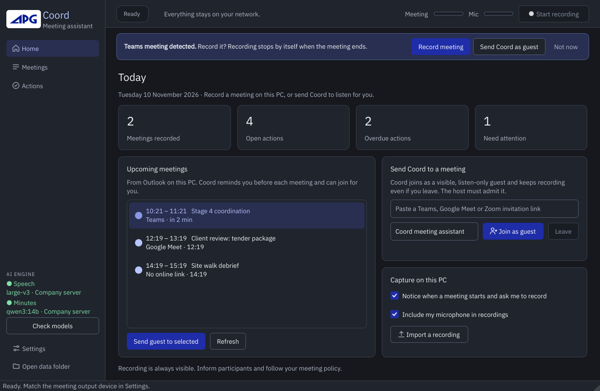

# Coord

**Your private AI coordination assistant.**

Local-first AI meeting intelligence for AECO teams: Arabic/English transcription, speaker detection, redaction, decisions, actions, risks, searchable history, and MCP integration with Claude Desktop.

No subscriptions. Speech-to-text, speaker detection and minutes extraction all run on your own PC (RTX GPU). Claude only ever sees a redacted version, where people, companies and projects are replaced by codes like `P01`, `ORG01` and `PRJ01`.

```
 Recording (OBS / Teams / phone)
        │  drop into ~/Coordy/inbox
        ▼
 ┌──────────────────────── your PC, offline ─────────────────────────┐
 │ Whisper large-v3 (GPU) ─► pyannote speakers ─► redaction (aliases) │
 │        │                                            │              │
 │   raw/ (real names, never shared)        coordy.db + redacted/     │
 │                                                     │              │
 │                       Ollama (qwen3:14b) ─► decisions / actions /  │
 │                                             risks / open questions │
 └─────────────────────────────────────────────────────┬─────────────┘
                                                       │ MCP (stdio), redacted only
                                                       ▼
                                        Claude Desktop: registers, MoM, analysis
```

## What you get

- **Transcription** of Arabic, English and mixed meetings (Whisper large-v3 with per-segment language detection and an AECO glossary).
- **Speaker detection** (S1, S2, …), which you map to codes (`S1 = P01`).
- **Redaction** of names (with Arabic spelling variants and attached prefixes such as و/ب/ل/ال), emails and phone numbers. It runs before anything is stored in the searchable database.
- **Minutes** extracted by a local LLM: summary, topics, decisions, actions (owner, due date), risks, open questions/RFIs, each with discipline and timestamp.
- **A project register across meetings**, stored in SQLite with full-text search. You can close, reassign or add items from Claude.
- **Exports**: Markdown minutes per meeting, CSV register for Excel, and locally generated minutes with real names restored for distribution.
- **13 MCP tools and 2 prompts** for Claude Desktop.

## Windows desktop application (phase one)



A native **APG-branded meeting assistant** for Windows:

- **Record without joining**: captures the meeting audio of this PC (plus your microphone if you want), notices when a Teams/Zoom/Meet call starts and asks whether to record it.
- **Upcoming meetings and reminders** from Outlook on the PC, with one click to record or to send Coord in.
- **Join as a guest**: a visible, listen-only participant that keeps recording after you leave.
- **Live captions** in Arabic, English and mixed speech that update every second, with optional live translation.
- **Minutes**: summary, decisions, actions, risks and open questions; export to PDF/Markdown or send to Teams/email.
- **Action register** across meetings with overdue tracking and a one-click agenda draft for the next meeting.
- **Runs on your hardware**: on the PC, or on a [company GPU server](docs/server.md) for the whole office. Nothing goes to the cloud.

```powershell
uv venv --python 3.12
uv pip install -e ".[desktop]"
# Install/start Ollama separately (or point Settings > AI engine at the company server), then:
.venv\Scripts\coordy setup-models
.venv\Scripts\coordy-desktop.exe
```

See **[desktop guide](docs/desktop.md)**, [company server setup](docs/server.md), [architecture](docs/desktop-architecture.md) and the [phase one status and roadmap](docs/roadmap.md). Automated tests use simulated audio and model back ends; real Windows capture, guest admission and recognition quality still need the acceptance run described in the desktop guide. Model weights download separately; no installer binary or weights are in Git.

## Install (Windows 11 + NVIDIA)

Full walkthrough: **[docs/setup-windows.md](docs/setup-windows.md)**.

```powershell
git clone https://github.com/OmarEAbdelaal/coord-scribe.git
cd coord-scribe
powershell -ExecutionPolicy Bypass -File scripts\install.ps1
```

Then:

```powershell
.venv\Scripts\coordy setup-models              # Whisper + speaker model + Ollama model, once
notepad $env:USERPROFILE\Coordy\aliases.toml   # names to hide
.venv\Scripts\coordy claude-config --write     # register in Claude Desktop, then restart it
.venv\Scripts\coordy doctor                    # everything should be [ OK ]
```

## Daily use

1. Record the meeting (OBS, Teams or your phone) and save or copy the file into `%USERPROFILE%\Coordy\inbox`.
2. In Claude Desktop:
   - *"Process the new recording in my Coord inbox, project PRJ01."*
   - *"Show me the minutes. S1 is P01 and S2 is P02. Regenerate the minutes."*
   - *"Write formal minutes of meeting for it"* (or use the `minutes_of_meeting` prompt).
   - *"List all open actions for PRJ01 grouped by discipline. Which are overdue?"*
   - *"What did we decide about the façade module across all meetings? Any contradictions?"*
   - *"Close action 14 with note 'model issued'."*
3. Or work without Claude:

```powershell
coordy process "C:\path\meeting.m4a" --project PRJ01 --title "Weekly coordination"
coordy watch                        # auto-process anything dropped in the inbox
coordy speakers <meeting> S1=P01 S2=P02
coordy minutes <meeting>            # re-run extraction
coordy named <meeting>              # minutes with real names, local file only
coordy export register.csv          # decision/action register for Excel
coordy suggest-aliases <meeting>    # local model lists names you have not hidden yet
```

## Privacy model

| Data | Where it lives | Who can read it |
|---|---|---|
| Recording | `Coordy\audio` | You only |
| Raw transcript (real names) | `Coordy\raw` | You only. No MCP tool reads it |
| Real names | `Coordy\aliases.toml` | You only. Claude sees codes and roles only |
| Redacted transcript, minutes, register | `Coordy\coordy.db`, `redacted\`, `minutes\` | You, and Claude through MCP |
| Local LLM | Ollama on `127.0.0.1` | Remote hosts are refused unless you allow them |

Also:

- Each MCP response is passed through the redactor again before it leaves the process.
- Hugging Face and pyannote telemetry are switched off. With `privacy.offline = true`, all model downloads are blocked once setup is done.
- What Claude receives is processed by Anthropic under your plan's terms. To keep a meeting fully offline, use the CLI only (`coordy process` + `coordy named`).

## Configuration

`%USERPROFILE%\Coordy\config.toml`: Whisper model, device and language; diarization; Ollama model and context size; privacy switches. `glossary.txt` holds technical terms that improve recognition. `minutes_prompt.txt` holds the extraction instructions; edit it to match your firm's MoM format.

Recommended models for an RTX 5080 (16 GB):

| Purpose | Default | Alternatives |
|---|---|---|
| Speech | `large-v3` | `large-v3-turbo`: ~3x faster, weaker on Arabic dialects |
| Minutes | `qwen3:14b` | `gemma3:12b` (strong Arabic), `qwen3:8b` (faster) |

## Development

```bash
uv venv --python 3.12 && uv pip install -e ".[dev,desktop]"
uv run --no-sync pytest -q
```

Tests use fake Whisper, diarization and Ollama backends, so they run anywhere, without models or a GPU.
