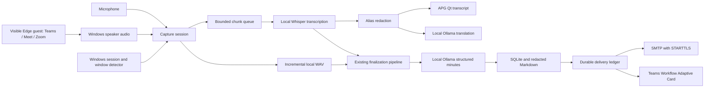

# Desktop architecture

The GUI thread owns widgets only. QThread workers own blocking device, browser, model and network operations. Capture uses a separate bounded transcription consumer while continuously writing audio to disk. A slow consumer causes a visible backlog notice and full-file transcription after stop. Transcription failures stop capture and retain audio. Completed live segments are passed to `Engine.process(segments=...)` to avoid transcribing the same meeting twice; optional diarization and the existing redaction/minutes pipeline still run. Empty speech never triggers minutes extraction.

Detection is independent from capture and opt-in. Stop is debounced to tolerate silence; a manual stop does not immediately restart while the same detection remains active. Guest admission is recognized from provider controls, not from a successful page navigation. A guest needs the PC and application to remain running. Browser UI selectors are best-effort and English; user interaction is the fallback.

Core files:

| Path | Responsibility |
| --- | --- |
| `src/coordy/desktop/app.py` | Main window (Home, Meetings, Actions), worker lifecycle and orchestration |
| `src/coordy/desktop/views.py` | Settings, action register, speaker naming, agenda draft |
| `src/coordy/desktop/ui.py` | Themed icons, cards, status pills, minutes document styling |
| `src/coordy/desktop/calendar.py` | Outlook calendar on this PC, join links, reminders |
| `src/coordy/desktop/server.py`, `src/coordy/remote.py` | Company AI server overlay and speech-server client (private networks only) |
| `src/coordy/desktop/capture.py` | Windows WASAPI loopback/mic, PCM mixing and resampling |
| `src/coordy/desktop/session.py` | Rolling live transcription (partials, pause commit), translation worker and finalization |
| `src/coordy/desktop/detection.py` | Meeting/presentation evidence and debounce state |
| `src/coordy/desktop/guest.py` | Provider URL validation and visible browser guest |
| `src/coordy/desktop/models.py` | Model download/readiness checks |
| `src/coordy/desktop/delivery.py` | Teams/SMTP adapters and durable duplicate protection |
| `src/coordy/desktop/settings.py` | Non-secret local desktop preferences |
| `src/coordy/desktop/assets/` | APG assets/tokens, Qt styles and licensed IBM fonts |
| `models/` | Model catalog and download instructions; no binary weights |
| `packaging/windows/` | PyInstaller entry/spec and Inno Setup installer |
| `.github/workflows/windows-desktop.yml` | Windows build, tests and frozen UI smoke check |

Delivery only consumes final redacted Markdown. Its ledger identity hashes meeting ID, destination and content; a transaction prevents parallel duplicate attempts. A provider timeout is ambiguous, so retries require user review. Model output remains untrusted text: transcript strings are HTML-escaped in the Qt live view. Secrets are read from environment variables at delivery time, and provider error strings are not saved in the ledger.

Future extensions should implement explicit adapters for authenticated provider media bots, OAuth mail, app-specific audio capture, streaming speaker separation, incremental minutes and bidirectional spoken translation. These capabilities are not implied by the initial browser guest path.
