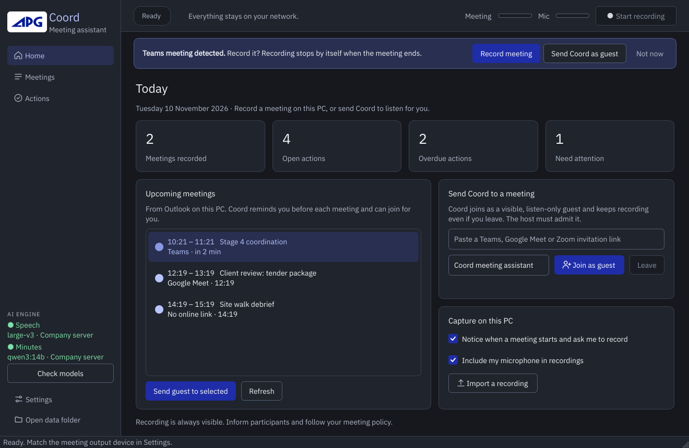

# Windows desktop phase one

Coord 0.3 is a native Windows meeting workspace using the APG Brand Kit. It captures the selected Windows speaker output and, optionally, your microphone; transcribes Arabic, English and mixed speech locally; optionally translates text using local Ollama; and extracts decisions, actions, risks and questions. Completed redacted minutes can be delivered through a Teams Workflow webhook or SMTP.

This is an initial implementation. Automated behavior is covered by tests with fake audio and model backends. Windows hardware capture, provider guest admission, real recognition quality and installer execution still need the acceptance checks below. No speech model guarantees every word, especially with overlapping speakers, dialects or poor audio.

## The workspace



| Screen | What it is for |
| --- | --- |
| **Home** (Ctrl+1) | Today's numbers, upcoming Outlook meetings, sending Coord as a guest, capture options and import. |
| **Meetings** (Ctrl+2) | Searchable library (titles and transcripts), live captions, minutes, transcript and translation, send/export, speaker naming. |
| **Actions** (Ctrl+3) | Every decision, action, risk and question across meetings. Tick to close, see overdue items, draft the next agenda. |
| **Top bar** | Recording state, timer, meeting/microphone levels and the single Start/Stop button (Ctrl+R). |
| **Sidebar** | AI engine health (where speech and minutes run, and whether they are reachable), Settings (Ctrl+,) and the data folder. |

Other shortcuts: Ctrl+I import a recording, Ctrl+F search meetings. Closing the window keeps Coord in the notification area so it can keep noticing meetings; quit from the tray icon. Switch this off in Settings › Meetings.

## Run from source on Windows 11 x64

Install Git, Microsoft Edge and [uv](https://docs.astral.sh/uv/getting-started/installation/). For summaries and translation, install [Ollama](https://ollama.com/download/windows), start it and run `ollama pull qwen3:14b` (about 9 GB). A smaller local model can be selected in `~/Coordy/config.toml` on lower-memory PCs.

```powershell
git clone https://github.com/OmarEAbdelaal/coord-scribe.git
cd coord-scribe
uv venv --python 3.12
uv pip install -e ".[desktop]"
.venv\Scripts\coordy init
.venv\Scripts\coordy setup-models
.venv\Scripts\coordy-desktop.exe
```

The model setup command downloads the configured Whisper model (default `large-v3`, about 3 GB) from Hugging Face and the configured LLM through local Ollama. It fails with a nonzero exit code if a required download fails. Model files live in the Hugging Face/Ollama cache, not Git. Internet is needed for installation and the initial downloads, not local inference. Allow Hugging Face and its `*.hf.co` weight-download hosts if using a restricted network.

Speaker labeling is optional. Without the diarization extra, live transcripts and minutes work without speaker identification. To install NVIDIA support and speaker identification from source:

```powershell
powershell -ExecutionPolicy Bypass -File scripts\install.ps1 -Desktop
```

Accept the [pyannote model terms](https://huggingface.co/pyannote/speaker-diarization-community-1) and securely configure `HF_TOKEN`, then rerun `coordy setup-models`. The packaged application omits optional PyTorch/pyannote and CUDA DLLs to keep its distribution manageable. It supports CPU inference; the source installation is recommended for NVIDIA and speaker labeling. CPU large-v3 can be substantially slower than real time. The live queue is bounded; if it falls behind, the complete recording is transcribed again after Stop, rather than silently omitting speech.

## Appearance

The interface follows the Windows light/dark appearance and updates when the system theme changes. Settings, confirmation dialogs, dropdowns and disabled controls share the same APG palette. The original APG logo is displayed with its aspect ratio preserved.

## Models and settings

The first launch creates `~/Coordy` (override with `COORDY_HOME`). Edit `config.toml` for Whisper model/device, language, glossary and Ollama model. Arabic/English code switching uses faster-whisper's multilingual mode. Inference uses existing pretrained models; training is not required. Real-time translation is text-only via the local LLM, selected as Arabic or English in desktop settings. It does not speak into the meeting. Translations are saved beside the redacted transcript.

Use **Download models** in the UI or `coordy setup-models`. A missing Ollama service, incomplete download or denied Hugging Face access is reported rather than marked successful. Once models are downloaded, set `privacy.offline = true` to prevent further Hugging Face downloads. The full `coordy doctor` also checks optional deployment features such as Claude Desktop and GPU availability.

Edit `aliases.toml` before sharing minutes. Only the redacted view is shown and delivered by the desktop app. Unknown names not present in the aliases file can remain visible; review the result. Raw audio and original transcripts remain local under `audio/` and `raw/`.

## Capture and detection

1. Open **Settings › Audio** and select the speaker or headset used by Teams/Zoom/your browser as **Meeting audio output**. The Windows default output can differ from a meeting app's communications output. Computer sound is always captured; the microphone is optional (also on Home).
2. Click **Start recording** (Ctrl+R), or let Coord notice the meeting.
3. Review the transcript, translation and minutes, then send or export (PDF, Markdown, or an internal copy with real names restored).

**Meeting detection** is on by default and only asks. When Teams, Zoom or Webex holds an active audio session, or a browser tab with a meeting-like title does, a banner and a Windows notification offer **Record meeting**. Nothing is recorded until you accept, unless you enable *Record detected meetings without asking*. A recording started this way stops by itself after the meeting ends (90-second grace, configurable). Detection needs two positive polls and is a heuristic: it can miss a meeting or react to other call audio. Concurrent meetings are recorded together.

**Upcoming meetings** come from classic Outlook on this PC through its local COM interface, including recurring meetings; nothing is sent anywhere. Coord reminds you before each meeting (2 minutes by default) and offers to record or to send the guest when the invitation contains a Teams, Meet or Zoom link. *Send the Coord guest to calendar meetings automatically* is off by default. The new Outlook app has no COM interface, so the list stays empty there; paste the link instead (a Microsoft Graph calendar adapter is on the roadmap).

The top bar has separate **Meeting** and **Mic** meters, measured before mixing. If computer sound stays silent for ten seconds, the status bar suggests checking the output selection. An unplugged saved device produces an error rather than silently switching to another endpoint. Capture diagnostics are in `logs/desktop.log`. Recordings shorter than one second report a capture-duration error.

Capture uses WASAPI loopback and includes **all audio** on that speaker device, not just a particular meeting. Keep unrelated applications quiet and use headphones to reduce duplicate mic pickup. The microphone and speaker streams are mixed; this does not provide per-participant tracks. Recordings are retained on processing errors: select the failed meeting and choose **More › Process recording again** after fixing the cause shown in its Minutes tab.

## Live captions panel

Starting a recording opens **Meetings › Live captions**. Audio reaches the speech model every second (Settings › Live captions, 1–10 s). The sentence being spoken is decoded again each second as it grows, shown dimmed, and corrected as more context arrives; at a pause of about half a second, or after 15 seconds without one, it settles as a final caption and joins the transcript. The design target on a GPU is text about one second plus model time after the words are spoken; this has not yet been measured on target hardware.

Use **Translate to** for Arabic or English text translation of each settled caption. Translation has its own worker with a small context and a 20-second timeout, so it cannot hold up captions; when it falls behind, only the newest caption is translated. A translation error is shown in the panel while recording continues. Saved translation history contains completed translations only.

## Reducing live latency

Latency is the update interval plus the time the model needs for the open sentence (up to 15 seconds of audio). Options, fastest first:

- **Company GPU server** for speech and minutes: see [server.md](server.md). Every PC then gets GPU speed without a GPU.
- **Fast caption model**: set Settings › Live captions › *Fast caption speech model* to `large-v3-turbo` (or `small` on CPU). Live captions use it; after you stop, the whole recording is transcribed again with the accurate model from `config.toml`, so minutes do not lose quality. Run `coordy setup-models` once per model name you use.
- **Lighter translation model**: `ollama pull qwen3:4b`, then enter it as *Translation model*.

On a CPU-only PC the large model cannot keep up in real time. Coord then merges waiting audio into one pass, and if it still falls more than 20 seconds behind it skips ahead; the recording stays complete and is transcribed in full after you stop.

## Join as a separate participant

On Home, paste a Teams, Google Meet or Zoom HTTPS invitation (or pick a calendar meeting), choose a visible name and click **Join as guest**. Coord keeps listening after you leave the meeting yourself, as long as this PC stays on. A separate Microsoft Edge window opens in a fresh browser context. Coord attempts common English guest-name/join controls and never bypasses a host lobby, authentication, CAPTCHA or organizational guest policy. Complete provider-specific steps in that window when needed. The participant is listen-only: microphone and camera permissions are denied. You hear its audio through this PC, and the Windows capture path transcribes it.

When a recognized Leave control becomes visible, the app reports the guest as joined and starts capture if idle. If the provider UI differs, use Start capture manually after verifying that the guest is admitted. **Leave guest** closes that guest browser and stops capture. Joining the same meeting from your personal client and this guest may duplicate audio; mute one playback source. No participant joins during installation or automated tests.

Supported provider domains: `teams.microsoft.com`, `teams.live.com`, `meet.google.com`, `zoom.us` and its subdomains. Desktop-only meetings, meeting links on organization redirect domains, localized join controls and providers which prohibit web guests require manual joining or a future provider adapter. This browser guest is not a Microsoft Graph/Azure or Zoom server-side media bot. A managed bot that joins when your PC is off requires a separately registered, hosted provider service and account permissions; it is outside this desktop implementation.

## Teams and email

No live messages are sent by tests or installation. Configure a destination before enabling automatic delivery.

**Teams:** create a Teams Workflow using the webhook trigger that posts an Adaptive Card to your chosen chat/channel. Use a template that accepts the message/attachments payload and the appropriate trigger authentication policy. Store its HTTPS URL in your Windows user environment as `COORDY_TEAMS_WEBHOOK` and restart Coord. Supported Workflow hosts end in `.logic.azure.com` or `.environment.api.powerplatform.com`; legacy Office connector webhooks are not supported. The app posts an Adaptive Card with the redacted Markdown. Summaries over 22 KB are rejected rather than truncated. A successful webhook response confirms acceptance by the workflow, not downstream Teams delivery; inspect Workflow run history on failure.

**Email:** enter SMTP host, STARTTLS port (usually 587), username, sender and recipients in Settings. Store the password or app password in `COORDY_SMTP_PASSWORD` in your Windows user environment and restart Coord. Only authenticated TLS connections are used. The adapter supports SMTP password authentication, not Microsoft Graph mail or Exchange OAuth. Exchange Online tenants that disable SMTP AUTH need a compatible relay/provider or a future OAuth adapter.

Credentials are not written to `desktop.json` or the delivery database. Do not commit webhook URLs, passwords, tokens or meeting recordings. The application re-redacts minutes immediately before export and delivery. Automatic delivery uses the selected channel only after successful final minutes generation. A failed send leaves the meeting and minutes intact.

`delivery.db` records delivery identities and results. Identical content to the same destination is not sent twice, including after restart. Failures require an explicit **Retry delivery** after checking whether the message arrived. Interrupted `sending` attempts can be manually retried after ten minutes. Remote services cannot guarantee exactly-once delivery when a connection fails after accepting a message; the app does not silently retry those requests.

## Build the Windows installer

Install [Inno Setup 6](https://jrsoftware.org/isinfo.php). Run on Windows:

```powershell
powershell -ExecutionPolicy Bypass -File scripts\build-desktop.ps1
```

This runs tests, builds the native app with PyInstaller and produces `dist/installer/Coord-Setup-0.3.0-x64.exe`. The portable app is `dist/Coord/Coord.exe`. The installer runs per user without administrator privileges, adds shortcuts, and preserves meeting data on uninstall. It includes application libraries and fonts, not Whisper/LLM weights or Ollama/Edge. It is unsigned; code signing needs your organization's signing certificate.

The **Windows desktop installer** GitHub Actions workflow can be run manually after it is available on the repository's default branch; tags named `desktop-v*` also trigger builds. It uploads the installer and portable app as a workflow artifact. It tests the frozen UI startup but cannot test real audio devices or hosted meetings. An artifact is not a published release.

## Development and acceptance checks

```bash
uv pip install -e ".[dev,desktop,package]"
uv run --no-sync pytest -q
uv build --wheel
```

On Linux, file processing and the interface can be tested; live capture/detection require Windows. `QT_QPA_PLATFORM=offscreen coordy-desktop --smoke-test` constructs and exits the actual UI without joining or recording.

Before daily use, validate on the target Windows PC:

- Install the generated installer, start Ollama and download models. Check CPU/GPU operation with a short known recording.
- Play a bilingual test recording; capture with microphone off and on, then verify both sources, timestamps, Arabic rendering, overlapping speech and final summaries.
- Try detection start/stop, extended silence, PowerPoint presentation, manual override, device failure and a long meeting slower than real-time transcription.
- Admit the named browser guest to test Teams, Meet and Zoom meetings. Verify camera/microphone remain off, then check guest leaving and capture stopping. Test host-denied admission separately.
- Send a sample redacted summary to a test Teams workflow and test mailbox; verify arrival, retries and duplicate protection.
- Restart the app and verify meeting history, transcripts, translations and minutes persist.

The prepared plugin has not been supplied or integrated. Existing MCP integration continues to work and can be used separately by Claude Desktop.
